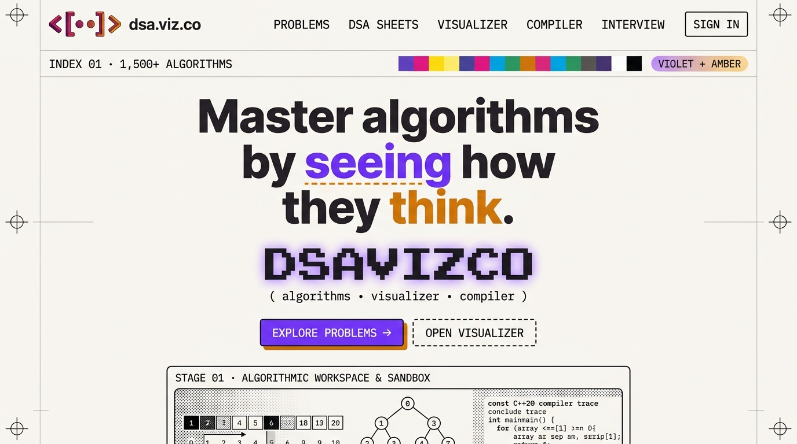
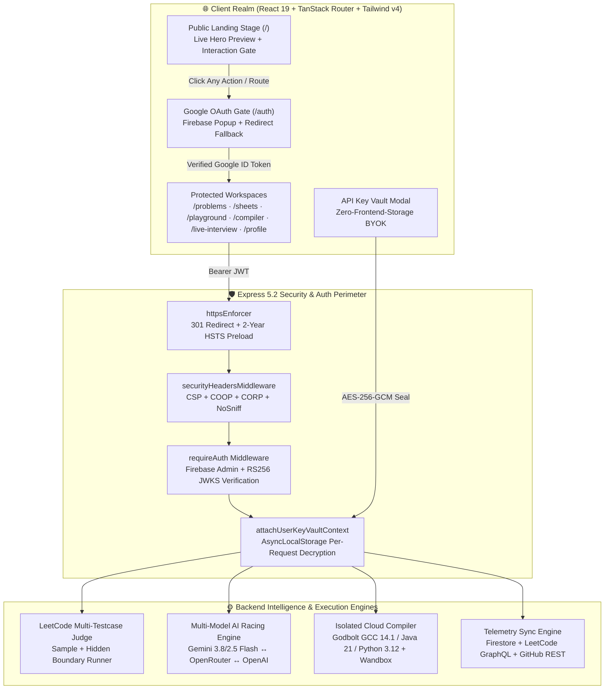
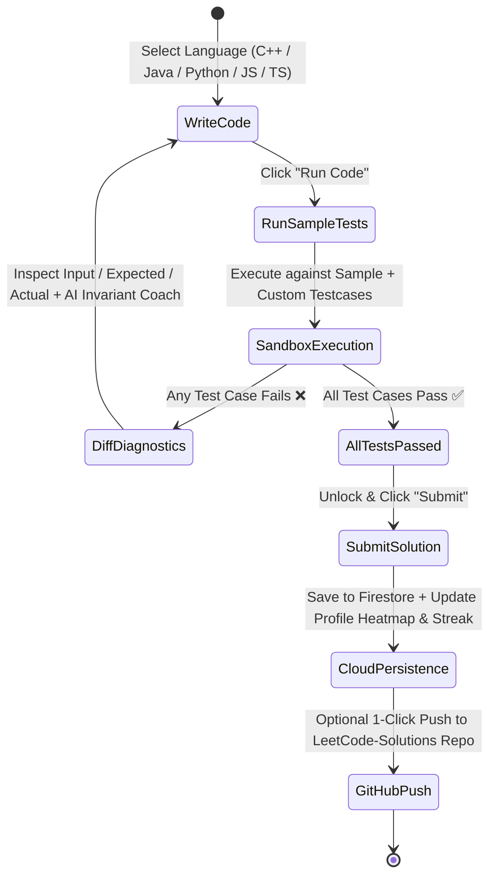

<div align="center">

<kbd>INDEX 01 &nbsp;·&nbsp; 1,500+ ALGORITHMS &nbsp;·&nbsp; STEP-BY-STEP VISUALIZER &nbsp;·&nbsp; C++20 SANDBOX</kbd>

<h1>⚡ DSA.viz.co — Master Algorithms by Seeing How They Think</h1>

<p>
  <b>The Interactive Neo-Brutalist Print-Tech Platform for Frame-by-Frame Algorithm Visualization, Dynamic Multi-Testcase Judging, Socratic AI Mentorship, and Proctored FAANG Mock Interviews.</b>
</p>

<p>
  <a href="https://github.com/isthatnkhl-byte/DSA.viz.co"></a>
  <a href="https://www.typescriptlang.org/"></a>
  <a href="https://react.dev/"></a>
  <a href="https://expressjs.com/"></a>
  <a href="https://ai.google.dev/"></a>
  <a href="#-zero-trust-security--google-oauth-architecture"></a>
</p>

<br />

<a href="https://github.com/isthatnkhl-byte/DSA.viz.co">
  
</a>

<br /><br />

<p>
  <a href="#-interactive-platform-tour"><b>🎛️ Interactive Tour</b></a> &nbsp;•&nbsp;
  <a href="#-dynamic-multi-testcase-judge-engine"><b>⚖️ Dynamic Judge</b></a> &nbsp;•&nbsp;
  <a href="#-curated-dsa-sheets--telemetry-profile"><b>📚 DSA Sheets & Profile</b></a> &nbsp;•&nbsp;
  <a href="#-multi-datastructure-visualization-engine"><b>📊 11 Visualizers</b></a> &nbsp;•&nbsp;
  <a href="#-system-architecture--execution-flow"><b>🏛️ Architecture</b></a> &nbsp;•&nbsp;
  <a href="#-zero-trust-security--google-oauth-architecture"><b>🛡️ Security Vault</b></a> &nbsp;•&nbsp;
  <a href="#-quickstart--vercel-deployment"><b>🚀 Quickstart & Deploy</b></a>
</p>

</div>

---

## 🎛️ Interactive Platform Tour

> [!TIP]
> **Click any module below** to expand its interactive architectural walkthrough, live UI states, and invariant mechanics.

<details open>
<summary><b>01 · 🎨 Neo-Brutalist Print-Tech Landing Stage & 12-Theme CMYK Calibration</b> <i>(Click to toggle)</i></summary>
<br />

The landing experience (`/` — publicly visible, with zero-trust authentication gating on all interactive actions) is engineered around a tactile **Print-Tech Editorial** aesthetic with corner registration bullseyes (`+`), halftone dot-matrix frames, and an interactive **12-Theme OKLCH Color Calibration Bar** that dynamically re-inks the entire platform:

| Swatch Code | Theme Name | Primary Ink (`--primary`) | Complementary Accent (`--complement`) | Visual Character |
| :---: | :--- | :--- | :--- | :--- |
| `VI` | **Purple (Default)** | Electric Violet `oklch(0.62 0.24 292)` | Warm Amber-Gold `oklch(0.75 0.17 75)` | High-contrast editorial print |
| `C` | **Cyan** | Process Cyan `oklch(0.64 0.18 208)` | Coral Vermilion `oklch(0.64 0.21 32)` | Blueprint engineering |
| `M` | **Rose** | Process Magenta `oklch(0.62 0.24 348)` | Mint Emerald `oklch(0.72 0.17 162)` | Swiss poster typography |
| `Y` | **Solar** | Solar Gold `oklch(0.78 0.19 75)` | Deep Ultramarine `oklch(0.55 0.22 268)` | High-luminance laboratory |
| `K` | **Obsidian** | Carbon Ink `oklch(0.22 0.02 260)` | Signal Orange `oklch(0.68 0.21 42)` | Monochrome brutalist |
| `EM` | **Emerald** | Forest Emerald `oklch(0.62 0.19 158)` | Warm Magenta `oklch(0.64 0.22 340)` | Terminal telemetry |
| `CY` | **Cyberpunk** | Neon Fuchsia `oklch(0.64 0.27 328)` | Acid Cyan `oklch(0.78 0.16 198)` | Synthwave night ops |

</details>

<details>
<summary><b>02 · ⚖️ Dynamic Multi-Testcase AI + Sandbox LeetCode Judge (1,500+ Problems)</b> <i>(Click to toggle)</i></summary>
<br />

Unlike static platforms that hardcode answers for a handful of problems, **DSA.viz.co** dynamically evaluates any of its **1,500+ problems** across **C++, C, Java, Python, JavaScript, TypeScript, and Pseudocode**:

1. **Canonical Sample & Hidden Edge-Case Generation (`src/lib/leetcode-testcases.ts`)**: Automatically extracts problem-specific sample inputs/outputs and synthesizes boundary test cases.
2. **Real Sandbox Execution + Deterministic Trace Verification (`src/lib/leetcode-judge.server.ts`)**:
   - Executes candidate solutions against every test case (`Case 1`, `Case 2`, `Case 3`, plus custom user inputs).
   - Returns per-case **Input**, **Your Output**, **Expected Output**, **Runtime (ms)**, and **Diff Diagnostics**.
3. **Strict Promotion Gate**: Only when **all test cases pass** (`allPassed === true`) does the submission unlock one-click **Submit & Persist to Cloud Profile + GitHub Sync**.

```
┌──────────────────────────────────────────────────────────────────────────────────┐
│ ✅ ACCEPTED · 3/3 Test Cases Passed · Runtime: 2 ms · Optimal: O(m · n)          │
├──────────────┬──────────────┬──────────────┬─────────────────────────────────────┤
│ [✓ Case 1]   │ [✓ Case 2]   │ [✓ Case 3]   │ [+ Custom Testcase]                 │
├──────────────┴──────────────┴──────────────┴─────────────────────────────────────┤
│ INPUT                                                                            │
│ grid = [[1,1,0,0],[1,1,0,0],[0,0,1,0],[0,0,0,1]]                                 │
│                                                                                  │
│ YOUR OUTPUT (1 ms)                         EXPECTED OUTPUT                       │
│ 4                                          4                                     │
└──────────────────────────────────────────────────────────────────────────────────┘
```

</details>

<details>
<summary><b>03 · 📚 Overhauled DSA Sheets Command Center (Search + Random Unsolved Spotlight)</b> <i>(Click to toggle)</i></summary>
<br />

A unified mastery workspace (`/sheets`) featuring curated roadmaps (**Striver SDE Sheet**, **NeetCode 150**, **Blind 75**, **Grind 75**, **Love Babbar 450**) with:

- **Global Cross-Sheet Search (`/` shortcut)**: Type any problem title, slug, or topic tag to search across all sheets simultaneously—even if the problem belongs to another sheet or topic filter—with one-click **"Search All Sheets"** expansion.
- **🎲 Random Unsolved Spotlight Banner**: Clicking **Random Unsolved** selects an unsolved problem, auto-expands its parent category, scrolls smoothly into view, and launches a dedicated **Spotlight Action Card** with direct **Solve in Compiler** and **Open Visualizer** actions.
- **Live Firebase Cloud Sync**: Automatically merges problems you've solved in the DSA.viz Judge with your manual checklist and starred bookmarks.

</details>

<details>
<summary><b>04 · 👤 Unified Profile & Telemetry Dashboard (`/profile`)</b> <i>(Click to toggle)</i></summary>
<br />

Both the Dashboard and Profile have been unified into a single real-time **Algorithmic Telemetry Command Center** (`/profile`) backed by Firebase Firestore + LeetCode GraphQL + GitHub OAuth:

- **Real-Time KPI Bento Grid**: Solved Count, Optimal Rate %, Current & Best Daily Streak, Average Runtime, and Topic Mastery Breakdown.
- **Unified 52-Week Activity Heatmap**: Combines your on-platform DSA.viz submissions with synced LeetCode submission calendars.
- **Interactive Submission Replay Vault**: Click any past submission to inspect your exact code, AI complexity audit, and replay the **saved step-by-step animation trace** right inside your profile.
- **One-Click GitHub Solution Sync**: Automatically commits accepted solutions to your `LeetCode-Solutions` repository with AES-256-GCM encrypted OAuth tokens.

</details>

<details>
<summary><b>05 · 🎙️ Proctored FAANG Live Mock Interview Suite (`/live-interview`)</b> <i>(Click to toggle)</i></summary>
<br />

Simulates a real 45-minute technical interview with a staff-level AI interviewer:

- **3-Tier Progressive Complexity Gate**:
  - **Tier 1 (Brute Force)**: Establish a working baseline and verify edge cases.
  - **Tier 2 (Better / Space-Time Tradeoff)**: Optimize time complexity using auxiliary data structures.
  - **Tier 3 (Optimal In-Place)**: Achieve optimal asymptotic time & space bounds.
- **Live Voice & Camera Proctoring**: Real-time WebAudio frequency telemetry, focus/tab-switch lockdown monitoring, and a full **FAANG Hiring Committee Scorecard** upon completion.

</details>

<details>
<summary><b>06 · 🔐 Zero-Knowledge AES-256-GCM Personal API Key Vault (`KEY VAULT`)</b> <i>(Click to toggle)</i></summary>
<br />

Want to run unlimited AI evaluations with your own **Google Gemini (`AIza...`)**, **OpenRouter (`sk-or-...`)**, or **OpenAI (`sk-...`)** key?

- **Zero Browser Storage**: Keys are never stored in `localStorage` or exposed to client JavaScript after submission.
- **AES-256-GCM Authenticated Encryption**: Keys are encrypted in backend memory using a scrypt-derived master key with the user's `ownerId` bound as Additional Authenticated Data (`AAD`), so ciphertexts cannot be transplanted across users.
- **Live Provider Verification**: Every key is live-tested against its provider before being sealed into the vault, returning only an irreversible masked hint (e.g. `AIza••••••••9x2Q`).

</details>

---

## 📊 Multi-Datastructure Visualization Engine

Every problem on **DSA.viz.co** automatically selects the optimal spatial renderer from **11 specialized canvas engines**:

| Engine | Target Algorithmic Patterns | Interactive Visual Telemetry |
| :--- | :--- | :--- |
| **`ArrayVisualizer`** | Two Pointers, Sliding Window, Binary Search, Quick/Merge Sort | Proportional bar heights, `L` / `R` / `mid` pointer badges, active window bounding boxes, swap arcs |
| **`MatrixVisualizer`** | 2D Grid DFS/BFS, Flood Fill, Island Counting, Shortest Path | Coordinate `(r, c)` cursor, 4-way directional arrows, visited cell states, island cluster coloring |
| **`TreeVisualizer`** | Binary Tree DFS/BFS, BST Validation, LCA, Serialization | Hierarchical SVG node layout, recursive call-stack breadcrumbs, active parent-child edge pulses |
| **`GraphVisualizer`** | Dijkstra, Kahn's Topological Sort, Union-Find, Cycle Detection | Force-directed & layered node topology, edge weights, in-degree badges, visited frontier glow |
| **`DpTableVisualizer`** | 1D/2D Knapsack, LCS, Edit Distance, Coin Change | Memoization grid, dependency arrows (`dp[i-1][j-1] → dp[i][j]`), recurrence formula readout |
| **`MonotonicStackVisualizer`** | Next Greater Element, Largest Rectangle in Histogram, Daily Temps | Vertical LIFO canister, push/pop animations, monotonic invariant violation highlights |
| **`StackQueueVisualizer`** | Valid Parentheses, BFS Level-Order Queue, Sliding Window Deque | Dual LIFO/FIFO lanes, head/tail markers, operation history badges |
| **`HashMapVisualizer`** | Two Sum, Group Anagrams, Subarray Sum Equals K, Frequency Maps | Key-value bucket slots, hash lookup flashes, collision/update counters |
| **`BinaryHeapVisualizer`** | Top-K Elements, Median Finder, Merge K Sorted Lists | Synchronized dual view: Complete Binary Tree SVG + underlying 0-indexed Heap Array |
| **`RecursionVisualizer`** | Backtracking, Permutations, Subsets, N-Queens, Memoized DFS | Live call-tree expansion, stack frame depth meter, base-case return value propagation |
| **`DesignDataStructureVisualizer`** | LRU Cache, LFU Cache, Trie (Prefix Tree), MinStack | Composite state inspector showing doubly-linked list order + hash map pointers simultaneously |

---

## 🏛️ System Architecture & Execution Flow

### 1. End-to-End Request & Zero-Trust Auth Pipeline



### 2. Dynamic Code Judging & Promotion Lifecycle



---

## 🛡️ Zero-Trust Security & Google OAuth Architecture

**DSA.viz.co** is hardened for production deployment with defense-in-depth controls across every layer:

| Security Layer | Implementation File | Protection Enforced |
| :--- | :--- | :--- |
| **Mandatory Google Sign-In Gate** | [`src/context/AuthContext.tsx`](src/context/AuthContext.tsx), [`src/components/AuthGuard.tsx`](src/components/AuthGuard.tsx) | No guest/explorer bypass personas. Only `/` and `/auth` render when signed out; clicking any link, button, or tool redirects to `/auth?redirect=<sanitized_path>`. |
| **Cryptographic JWT Verification** | [`src/middleware/auth.ts`](src/middleware/auth.ts) | Every `/api/*` endpoint (except `/api/health`) enforces [`requireAuth`](src/middleware/auth.ts), validating RS256 signatures, `iss`, `aud`, `exp`, and `sub`. |
| **Strict HTTPS & HSTS Preload** | [`src/middleware/security.ts`](src/middleware/security.ts), [`vercel.json`](vercel.json) | 301 permanent redirect to `https://` on all non-loopback hosts, `Strict-Transport-Security: max-age=63072000; includeSubDomains; preload`, and CSP `upgrade-insecure-requests`. |
| **AES-256-GCM Secret Vault** | [`src/lib/user-keys.server.ts`](src/lib/user-keys.server.ts) | User API keys and GitHub OAuth tokens are encrypted with `aes-256-gcm` + per-record random IV + `ownerId` Additional Authenticated Data (`AAD`) and bound to `HttpOnly; SameSite=Strict; Secure` signed cookies. |
| **Isolated Remote Code Execution** | [`src/lib/compiler/index.ts`](src/lib/compiler/index.ts) | Untrusted C/C++/Java/Python code never runs in a host `vm`; execution is dispatched to isolated Godbolt and Wandbox sandboxes with strict CPU and memory limits. |

---

## 📁 Repository Blueprint

```text
DSA.viz.co/
├── api/
│   ├── index.js                         # Vercel Serverless Function entrypoint
│   └── server.cjs                       # Bundled production Express + AI + Judge server
├── public/
│   ├── og-image.jpg                     # 16:9 Neo-Brutalist Landing Page OpenGraph cover
│   ├── og-image.png                     # High-DPI banner preview
│   └── favicon.svg                      # 3D < [ • • ] / > mascot icon
├── src/
│   ├── components/
│   │   ├── AuthGuard.tsx                # Zero-trust client route guard
│   │   ├── ApiKeyVaultModal.tsx         # AES-256-GCM BYOK modal UI
│   │   ├── SiteHeader.tsx               # Navigation, theme picker, Key Vault & Auth controls
│   │   ├── compiler/                    # C/C++/Java/Python IDE, console & STL explorer
│   │   ├── editor/
│   │   │   ├── MonacoCodeEditor.tsx     # Multi-language Monaco editor
│   │   │   └── LeetCodeTestDrawer.tsx   # Per-testcase runner & diff diagnostic drawer
│   │   ├── landing/                     # Neo-Brutalist Print-Tech Hero & live showcase
│   │   └── visualizer/                  # 11 specialized data-structure canvas engines
│   ├── context/
│   │   └── AuthContext.tsx              # Firebase Google OAuth session & profile provider
│   ├── db/                              # Firestore + Redis + /tmp/.data persistence layer
│   ├── lib/
│   │   ├── leetcode-judge.server.ts     # Dynamic multi-testcase AI + sandbox judge
│   │   ├── leetcode-testcases.ts        # Canonical testcase & signature extractor
│   │   ├── openrouter.server.ts         # Multi-model racing & failover engine
│   │   └── user-keys.server.ts          # AES-256-GCM backend API key vault
│   ├── middleware/
│   │   ├── auth.ts                      # RS256 Google OAuth bearer token verifier
│   │   └── security.ts                  # HTTPS enforcer, HSTS, CSP, COOP & CORP headers
│   └── routes/
│       ├── index.tsx                    # Public landing page with interaction gate
│       ├── auth.tsx                     # Google Sign-In portal with safe redirect handling
│       ├── sheets.tsx                   # Overhauled DSA Sheets hub with spotlight randomizer
│       ├── compiler.tsx                 # Multi-language sandbox IDE
│       ├── live-interview.tsx           # 3-Tier proctored FAANG mock interview room
│       ├── problem.$slug.tsx            # Problem workspace, visualizer & testcase judge
│       └── _authenticated/
│           └── profile.tsx              # Unified Profile + Dashboard telemetry hub
├── server.ts                            # Full-stack Express 5 API & Vite middleware server
├── vercel.json                          # Vercel serverless routing, maxDuration=60 & headers
└── package.json                         # Build scripts, dependencies & test runner
```

---

## 🚀 Quickstart & Vercel Deployment

<details open>
<summary><b>💻 Local Development Setup (3 Minutes)</b></summary>
<br />

```bash
# 1. Clone the repository
git clone https://github.com/isthatnkhl-byte/DSA.viz.co.git
cd DSA.viz.co

# 2. Install dependencies
npm install

# 3. Copy the environment template and fill in your keys
cp .env.example .env

# 4. Start the full-stack development server (Express 5 + Vite HMR on http://localhost:3000)
npm run dev
```

</details>

<details>
<summary><b>☁️ Deploying to Vercel (Production Checklist)</b></summary>
<br />

1. **Import Repository on Vercel**:
   - Connect `https://github.com/isthatnkhl-byte/DSA.viz.co.git` in the [Vercel Dashboard](https://vercel.com/new).
   - Vercel automatically detects [`vercel.json`](vercel.json) (`buildCommand: "npm run build"`, `outputDirectory: "dist"`, `functions.api/index.js.maxDuration: 60`).
2. **Configure Environment Variables in Vercel (`Settings → Environment Variables`)**:
   - **Server Secrets** *(never prefix with `VITE_`)*:
     - `GEMINI_API_KEY` — Google Gemini API key
     - `OPENROUTER_API_KEY` — OpenRouter fallback key (optional)
     - `ENCRYPTION_KEY` — 32+ character secret for AES-256-GCM vault encryption
     - `GITHUB_CLIENT_ID` & `GITHUB_CLIENT_SECRET` — GitHub OAuth credentials
     - `LIVEKIT_URL`, `LIVEKIT_API_KEY`, `LIVEKIT_API_SECRET` — LiveKit voice interview credentials (optional)
   - **Public Client Firebase Config**:
     - `VITE_FIREBASE_API_KEY`
     - `VITE_FIREBASE_AUTH_DOMAIN`
     - `VITE_FIREBASE_PROJECT_ID`
     - `VITE_FIREBASE_STORAGE_BUCKET`
     - `VITE_FIREBASE_MESSAGING_SENDER_ID`
     - `VITE_FIREBASE_APP_ID`
3. **Authorize Your Vercel Domain in Firebase**:
   - In **Firebase Console → Authentication → Settings → Authorized domains**, add your `.vercel.app` or custom production domain so Google Sign-In popups are permitted.

</details>

<details>
<summary><b>🧪 Verification & Automated Test Commands</b></summary>
<br />

```bash
# Typecheck the entire frontend & backend (0 errors)
npm run lint

# Run the security, auth, simulator, and pipeline test suite
npm test

# Build production client assets (dist/) and serverless bundle (api/server.cjs)
npm run build
```

</details>

---

<div align="center">

**Built with precision by [Nikhil (`@isthatnkhl-byte`)](https://github.com/isthatnkhl-byte)**  
*Master algorithms by seeing how they think.*

[](https://github.com/isthatnkhl-byte/DSA.viz.co)

</div>
