# DSA.viz.co — Advanced AI Algorithm Interviewer & Step-by-Step Visualizer

<div align="center">

[](https://www.typescriptlang.org/)
[](https://react.dev/)
[](https://expressjs.com/)
[](https://firebase.google.com/)
[](https://tailwindcss.com/)
[](https://ai.google.dev/)
[](https://nodejs.org/)
[](LICENSE)

**An enterprise-grade DSA interview preparation platform combining real-time AI code reviews, deterministic multi-dataset algorithm visualization, and a sandboxed C++ compilation engine.**

[Explore Problems](#-curated-faang-problem-catalog) • [Architecture](#-system-architecture) • [Visualizer Engine](#-multi-datastructure-visualization-engine) • [C++ Compiler](#-high-performance-c-compiler-sandbox) • [Getting Started](#-getting-started) • [Resume Highlights](#-faang-resume-ready-bullet-points)

</div>

---

## 📌 Executive Summary

**DSA.viz.co** is a modern pair-programming and interview coaching ecosystem designed to bridge the gap between abstract algorithmic reasoning and visual mental models. Users submit pseudocode in any mainstream programming language (C++, Java, Python, JavaScript, Go, Rust), receiving:

1. **Instant FAANG-Grade AI Verdicts:** Comprehensive breakdown of algorithmic correctness, asymptotic time & space complexity, edge-case vulnerabilities, and actionable optimization strategies.
2. **Deterministic Step-by-Step Visualizations:** Multi-dataset animations for 2D Grid DFS/BFS, 2D/1D Dynamic Programming state tables, Binary Trees, Linked Lists, Dynamic Hash Maps, Monotonic Stacks, Priority Queues, Tries, and Two-Pointer arrays.
3. **Integrated C++ Execution Sandbox:** Instant compilation and execution environment with a 16-header standard package explorer, compiler flags (`-O2`, `-std=c++20`), and performance profiling.

---

## 🏛 System Architecture

```mermaid
flowchart TD
    subgraph Client["Client Tier (React 19 + TanStack Router)"]
        UI["DSA.viz.co Modern UI"]
        Editor["Monaco / Code Editor"]
        Viz["Multi-DS Canvas Engine"]
        CompUI["C++ Console & Package Tree"]
        ApiClient["Typed API Client (src/lib/api-client.ts)"]
    end

    subgraph Server["Fullstack Server Tier (Node.js + Express API)"]
        AuthGate["requireAuth Middleware (Firebase Admin JWT verifyIdToken)"]
        RateLimiters["Rate Limiters (aiLimiter, compilerLimiter, apiLimiter)"]
        ReviewAPI["POST /api/review"]
        VizAPI["POST /api/visualize-dataset"]
        CompilerAPI["POST /api/compiler/execute"]
        OAuthAPI["OAuth Lifecycle (/api/github/url + /api/github/callback)"]
    end

    subgraph CoreEngine["Core Algorithmic Engines"]
        ModelRace["Multi-Model Race Engine"]
        ContractNormalizer["AI Contract Normalizer & AST Heuristics"]
        DeterministicSim["Ground-Truth Simulation Engines (50+ Patterns)"]
        CompilerSandbox["Compiler Explorer (Godbolt) & Wandbox Sandboxes"]
    end

    subgraph CloudInfrastructure["External Services & Databases"]
        Gemini["Google Gemini 3.5 Flash / 3.1 Flash-Lite"]
        OpenRouter["OpenRouter Fallback Pool"]
        FirestoreDB[("Google Cloud Firestore")]
        FirebaseAuth["Firebase Authentication"]
    end

    Editor -->|Submit Pseudocode| ApiClient
    ApiClient --> RateLimiters
    RateLimiters --> AuthGate
    AuthGate --> ReviewAPI
    AuthGate --> VizAPI
    AuthGate --> CompilerAPI

    ReviewAPI --> ModelRace
    VizAPI --> ModelRace

    ModelRace --> Gemini
    ModelRace -.->|Fallback| OpenRouter
    ModelRace --> ContractNormalizer

    ContractNormalizer -->|Payload Validation| DeterministicSim
    ContractNormalizer -->|Structured Steps| Viz

    CompilerAPI --> CompilerSandbox
    CompilerSandbox --> CompUI

    AuthGate <--> FirebaseAuth
    Server <--> FirestoreDB
```



---

## 🚀 Key Innovations & Engineering Highlights

### 1. Self-Healing Multi-Model AI Contract Normalizer
- **Problem:** LLMs frequently emit out-of-order execution steps, skip recursive DFS calls, sever multi-island grids, or freeze line numbers.
- **Solution:** Built a layered normalization pipeline (`ai-contracts.ts`) that verifies topological DFS/BFS invariants, checks 4-directional connected components on 2D matrices, enforces FIFO queue semantics on Tree BFS, and dynamically maps step mutations to line boundaries via AST heuristic parsing.

### 2. Multi-Dataset Problem Architecture
- Every problem is backed by 3 canonical, curated dataset variations:
  - **Dataset 1: Standard Case** — Canonical test case for establishing foundational intuition.
  - **Dataset 2: Longer & Complex Trace ⚡** — Stress test with deeper recursion, multiple components, or heavier edge distributions.
  - **Dataset 3: Edge & Boundary Case** — Minimal inputs, singleton arrays, empty queues, or boundary targets.

### 3. Sub-2s AI Race Engine with Zero-Downtime Fallback
- Concurrently races fast LLMs (`gemini-3.6-flash`, `gemini-3.1-flash-lite`, `gemini-flash-latest`) with robust schema validation. If API quotas or timeouts occur, automatically falls back to secondary provider pools or deterministic local AST simulation engines without dropping user requests.

### 4. Zero-Flicker TanStack Start RPC Pipeline
- Utilizes fullstack type-safe RPC server functions (`createServerFn`) integrated directly with React 19 SSR. Eliminates boilerplate REST endpoints while guaranteeing type safety from database models down to UI canvas props.

---

## 🎨 Multi-Datastructure Visualization Engine

| Data Structure | Visualization Paradigm | Active Visual Indicators |
|---|---|---|
| **2D Grid & Islands** | 4-Directional recursive matrix canvas | Active cell `(r,c)`, cumulative `visited` set, current island cluster shading, 4-way direction vectors (`UP`, `DOWN`, `LEFT`, `RIGHT`), dynamic `currentArea` and `maxArea` counters. |
| **Binary Tree & BST** | Hierarchical level-order layout with SVG edges | Active node, DFS call stack, dynamic BFS FIFO queue buffer, left/right child branch highlights, subtree bounds. |
| **Linked List** | Linear pointer sequence with directional arrows | `head`, `prev`, `curr`, `next`, `fast`/`slow` pointer badges, node val update animations, cycle detection loops. |
| **Dynamic Hash Map & Set** | Key-Value lookup slots & hash bucket buckets | Key insertion, bucket collision chaining, key updates, lookup hits/misses, size counters. |
| **Two-Pointer / Array** | Indexed scalar bars & sliding window bounds | `L` / `R` / `mid` pointer indicators, window highlight overlay, element swap transitions, binary search convergence. |
| **Monotonic Stack & Queue** | Vertical LIFO / Horizontal FIFO canisters | Push/Pop operations, top-of-stack badges, monotonic balance invariants, auxiliary return arrays. |

---

## ⚡ High-Performance C++ Compiler Sandbox

The embedded C++ compiler provides an authentic IDE experience tailored for competitive programming:

- **16-Header Standard Package Explorer:** Full interactive documentation and reference for `<vector>`, `<algorithm>`, `<unordered_map>`, `<queue>`, `<stack>`, `<set>`, `<iostream>`, `<cmath>`, `<numeric>`, and more.
- **Multi-Backend Execution Engine:** Dispatches compilation tasks to high-availability Piston and Wandbox sandboxes with compiler flag controls (`-O2`, `-O3`, `-std=c++20`, `-Wall`).
- **Real-Time Telemetry:** CPU execution time (ms), memory footprint (KB), compiler warnings, and standard output/error separation.

---

## 📚 Curated FAANG Problem Catalog

The repository includes **600+ curated problems** categorized across all core algorithmic paradigms:

- **Arrays & Hashing:** Two Sum, Group Anagrams, Longest Consecutive Sequence, Top K Frequent Elements.
- **Two Pointers & Sliding Window:** 3Sum, Container With Most Water, Longest Substring Without Repeating Characters, Minimum Window Substring.
- **Stack & Monotonic Queue:** Valid Parentheses, Daily Temperatures, Min Stack, Largest Rectangle in Histogram.
- **Binary Search:** Binary Search, Search a 2D Matrix, Find Minimum in Rotated Sorted Array, Koko Eating Bananas.
- **Linked Lists:** Reverse Linked List, Merge Two Sorted Lists, Reorder List, LRU Cache.
- **Trees & Graphs:** Maximum Depth, Level Order Traversal, Validate BST, Number of Islands, Max Area of Island, Course Schedule, Rotting Oranges.
- **Dynamic Programming & Greedy:** Climbing Stairs, House Robber, Coin Change, Longest Increasing Subsequence, Jump Game.

---

## 🛠 Tech Stack & Dependencies

| Layer | Technology | Purpose |
|---|---|---|
| **Framework** | [React 19](https://react.dev/) + [TanStack Start](https://tanstack.com/start) | SSR framework, server-side data loading, type-safe RPC |
| **Routing** | [TanStack Router](https://tanstack.com/router) | 100% type-safe file-based client and server routing |
| **State Management** | [TanStack Query](https://tanstack.com/query) + [Zustand](https://github.com/pmndrs/zustand) | Server state caching, optimistic UI, local theme store |
| **Styling** | [Tailwind CSS v4](https://tailwindcss.com/) + [Radix UI](https://www.radix-ui.com/) | Modern design system, accessible UI primitives |
| **Icons & Typography** | [Lucide React](https://lucide.dev/) + Inter & JetBrains Mono | Crisp iconography and developer-focused typography |
| **AI Intelligence** | Google Gemini 3.6 Flash / OpenRouter | Automated code reviews, complexity analysis, step traces |
| **Backend & Auth** | [Supabase](https://supabase.com/) | Authentication (OAuth/JWT), profile stats, submission history |
| **Build & Bundler** | [Vite 8](https://vite.dev/) + [Rolldown](https://rolldown.rs/) | Sub-second HMR, tree-shaking, production SSR bundling |
| **Testing** | Node.js Test Runner (`node --test`) | Zero-dependency TypeScript test runner (45 automated test suites) |

---

## 📂 Repository Structure

```
dsa.viz/
├── src/
│   ├── components/                # React UI Component Library
│   │   ├── compiler/              # C++ Compiler, Package Explorer, Console
│   │   ├── problem/               # Problem layout, Dataset toolbar, Review cards
│   │   ├── ui/                    # Accessible Radix UI primitives (Button, Dialog, Tabs)
│   │   └── visualizer/            # Multi-DS Visualizer Canvas Engines
│   │       ├── ArrayVisualizer.tsx
│   │       ├── GraphVisualizer.tsx
│   │       ├── HashMapVisualizer.tsx
│   │       ├── LinkedListVisualizer.tsx
│   │       ├── MatrixVisualizer.tsx
│   │       ├── StackVisualizer.tsx
│   │       └── TreeVisualizer.tsx
│   ├── data/                      # Problem database & canonical statements
│   │   ├── problems.json          # 600+ structured problem definitions
│   │   └── statements.json        # Formatted markdown problem statements
│   ├── integrations/              # External Integrations (Supabase, Auth)
│   ├── lib/                       # Core Algorithmic & AI Engine
│   │   ├── ai-contracts.ts        # Contract normalization, topological validators, AST scoping
│   │   ├── compiler.functions.ts  # C++ compilation RPC server function
│   │   ├── openrouter.server.ts   # Multi-model racing engine & API callers
│   │   ├── problems.ts            # Problem lookup, multi-dataset generator
│   │   ├── prompts/               # Structured LLM system & user prompt templates
│   │   ├── review.functions.ts    # Pseudocode review & trace generation RPCs
│   │   └── simulators.ts          # Deterministic local simulation engines (45+ algorithms)
│   ├── routes/                    # TanStack Start File-Based Routes
│   │   ├── _authenticated/        # Protected routes (Dashboard, Profile)
│   │   ├── auth.tsx               # Login / Signup authentication flow
│   │   ├── compiler.tsx           # Standalone C++ IDE & Compiler Sandbox
│   │   ├── index.tsx              # Problem explorer & company filtering
│   │   ├── playground.tsx         # Freeform algorithm visualizer playground
│   │   └── problem.$slug.tsx      # Problem solver, AI interviewer & visualizer workspace
│   ├── server.ts                  # Nitro / SSR entry point with error boundaries
│   └── start.ts                   # TanStack Start middleware & auth setup
└── vite.config.ts                 # Build & SSR configuration
```

---

## 🚀 Getting Started

### Prerequisites
- **Node.js**: `v20.x` or higher (or [Bun](https://bun.sh/) `v1.2+`)
- **API Keys**: Google Gemini API Key or OpenRouter API Key

### Installation

```bash
# 1. Clone the repository
git clone https://github.com/isthatnkhl-byte/dsa.viz.git
cd dsa.viz

# 2. Install dependencies
npm install

# 3. Configure environment variables
cp .env.example .env
```

Add your API credentials to `.env`:
```env
GEMINI_API_KEY=your_gemini_api_key_here
OPENROUTER_API_KEY=your_openrouter_api_key_here
VITE_SUPABASE_URL=your_supabase_url
VITE_SUPABASE_ANON_KEY=your_supabase_anon_key
```

### Running Development Server

```bash
npm run dev
```

Visit `http://localhost:3000` to access the application.

---

## 🧪 Testing & Code Quality

The codebase enforces strict static analysis, type checking, and automated unit testing:

```bash
# Run unit & contract normalization tests
npm test

# Run TypeScript type verification
npx tsc --noEmit

# Run ESLint linter
npx eslint src/

# Test production SSR build
npm run build
```

---

## 📄 License

This project is licensed under the [MIT License](LICENSE).