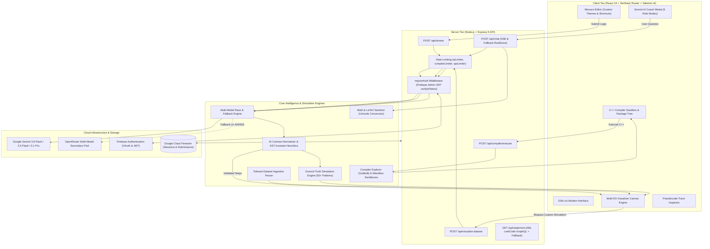

<div align="center">

# ⚡ DSA.viz.co

### *Advanced AI Algorithm Interviewer, Step-by-Step Visualizer & C++ Compiler Sandbox*

<br/>

[](https://dsa-viz.co)
[](https://www.typescriptlang.org/)
[](https://react.dev/)
[](https://expressjs.com/)
[](https://firebase.google.com/)
[](https://tailwindcss.com/)
[](https://ai.google.dev/)
[-success?style=for-the-badge&logo=node.js&logoColor=white)](https://nodejs.org/)
[](LICENSE)

<br/>

<a href="https://dsa-viz.co">
  
</a>

<br/><br/>

**An enterprise-grade algorithmic interview training ecosystem uniting real-time Gemini AI code reviews, Socratic mentoring, deterministic multi-dataset visualizations, and a sandboxed C++ execution playground.**

[Live Platform](https://dsa-viz.co) • [Key Features](#-key-features--innovations) • [System Architecture](#-system-architecture) • [Visualization Engines](#-multi-datastructure-visualization-matrix) • [AI Reviewer & Coach](#-dual-gemini-ai-intelligence-tier) • [Getting Started](#-getting-started) • [Resume Highlights](#-faang-resume-ready-engineering-bullets)

</div>

---

## 📌 Executive Summary

**DSA.viz.co** bridges the cognitive gap between abstract algorithmic syntax and spatial mental models. Traditional LeetCode prep forces engineers to mentally simulate pointer mutations, recursion trees, and dynamic programming tables in their head. 

With **DSA.viz.co**, developers draft logic in pseudocode or production languages (Python, C++, Java, JavaScript, Go, Rust), immediately receiving:
1. **Top-Tier Socratic AI Mentoring:** Socratic questioning that nudges without spoiling answers, automated complexity ratings ($O(N \log N)$), syntax slip diagnosis, and on-demand general coaching with manual context detachment.
2. **Deterministic Step-by-Step Simulations:** Scrubbable frame-by-frame animations for 2D Grid DFS/BFS, Linked List multi-pointers (`dummy`, `slow`, `fast`, `curr`, `prev`), Binary Search trees, Dynamic Programming grids, Tries, and Monotonic Stacks.
3. **Tolerant Custom Dataset Ingestion:** Flexible test case parser accepting unbracketed, multiline, and quote-free custom inputs for arrays, matrices, and trees.
4. **Sandboxed C++ Compiler IDE:** Sub-second code compilation with a 16-header standard library explorer (`<vector>`, `<algorithm>`, `<unordered_map>`, `<queue>`) and CPU/memory telemetry.

---

## 🏛 System Architecture



---

## 🚀 Key Features & Innovations

### 1. Multi-Persona Gemini Socratic AI Coach
- **5 Dedicated Personas:**
  - **Socratic Interviewer:** Emulates a top-tier FAANG interviewer—nudging thinking with diagnostic questions instead of giving away direct code answers.
  - **General Coach (Unrestricted):** Direct, comprehensive answers with full code implementations in Python, C++, Java, and JS for broad CS concepts and system design.
  - **Step Doubts Guide:** Pinpoints exactly what changed in active variables during any given animation frame.
  - **Submission Rater:** Provides balanced 1–10 numerical scoring, complexity proofs, and optimization nudges.
  - **Mistakes Lint:** Flags off-by-one errors, infinite loops, and boundary traps.
- **Manual Context Dismissal (`X`):** Easily detach the active problem context via a cross button on the context banner to switch between strict Socratic problem interview mode and general unconstrained assistance.
- **Horizontal Scrolling Code Blocks:** High-contrast snippet containers with dedicated horizontal sliders, eliminating cut-off code.
- **Mathematical Unicode Normalizer:** Sanitizes LaTeX equations and Big-O notation, transforming raw escaped symbols into clean Unicode (`O(N log N)`, `≤`, `≥`, `≠`, `×`, `·`, `√n`) without weird `%` or broken LaTeX comment artifacts.

### 2. Multi-Datastructure Visualization Canvas
- **Linked Lists Multi-Pointer Engine:** Renders badges for arbitrary concurrent pointers (`dummy`, `slow`, `fast`, `curr`, `prev`, `next`, `head`, `tail`, `l1`, `l2`) with semantic emerald, cyan, and violet color coding.
- **2D Matrix & Island Grids:** Visualizes 4-directional DFS/BFS traversals (`UP`, `DOWN`, `LEFT`, `RIGHT`), visited coordinates, and dynamic area counters.
- **Hierarchical Trees & BSTs:** Level-order layouts, recursive call stacks, and BFS FIFO queue buffers.
- **Dynamic Programming Matrices:** Animated cell-by-cell table updates with arrow dependencies.
- **Monotonic Stacks & Heaps:** Interactive push/pop canister animations and min/max heap bubble-up/down visual states.

### 3. Tolerant Custom Dataset Ingestion
- Ingests test cases without rigid JSON formatting requirements.
- Automatically normalizes bracketless inputs (`1, 2, 3` or `1 2 3`), multiline matrix rows, and tree null pointers (`null`, `None`, `#`).

### 4. High-Performance C++ Sandbox
- Authentic competitive programming IDE powered by Wandbox/Godbolt backends.
- **16-Header Standard Package Explorer:** Quick interactive documentation for `<vector>`, `<algorithm>`, `<unordered_map>`, `<queue>`, `<stack>`, `<set>`, `<cmath>`, `<numeric>`, and more.
- Execution telemetry including CPU time (ms), peak memory (KB), compiler warnings, and exit codes.

---

## 🎨 Multi-Datastructure Visualization Matrix

| Data Structure | Visualization Paradigm | Active Visual Indicators |
|---|---|---|
| **Singly-Linked List** | Linear node sequence with animated arrows | Multi-pointer badges (`dummy`, `slow`, `fast`, `curr`, `prev`, `next`), value mutation pulses, cycle detection links. |
| **2D Grid & Islands** | 4-Directional recursive matrix canvas | Active cell `(r,c)`, cumulative `visited` set, island cluster shading, 4-way direction vectors, real-time area counters. |
| **Binary Tree & BST** | Hierarchical SVG tree layout | Active node, DFS recursion stack, dynamic BFS FIFO queue buffer, left/right branch highlights. |
| **2D / 1D Dynamic Programming** | Interactive state transition table | Current cell `dp[i][j]`, dependency cell highlights, base-case initialization, recurrence animation. |
| **Two-Pointer Array** | Indexed scalar bars & sliding window | `L` / `R` / `mid` pointer indicators, window boundary overlays, element swap transitions. |
| **Dynamic Hash Map & Set** | Key-Value lookup slots & hash buckets | Key insertion, collision chaining, key updates, lookup hits/misses, size counters. |
| **Monotonic Stack & Queue** | Vertical LIFO / Horizontal FIFO canisters | Push/Pop operations, top-of-stack markers, monotonic balance invariants. |
| **Trie (Prefix Tree)** | Branching letter tree nodes | Word insertion paths, prefix search traversals, end-of-word terminal badges. |

---

## 🛠 Tech Stack & Ecosystem

```
Frontend:
├── React 19 (Concurrent Rendering)
├── TanStack Router (100% Type-Safe File-Based Routing)
├── TanStack Query v5 (Server State & Cache Invalidation)
├── Tailwind CSS v4 (Modern Design System & OKLCH Palettes)
├── Monaco Editor (@monaco-editor/react with Custom Keybindings)
└── Lucide React (Pixel-Perfect Iconography)

Backend & Server:
├── Express.js 5 (Modern REST & Streaming API)
├── Google GenAI SDK (@google/genai — Gemini 3.8 & 3.1 Pro)
├── Firebase Admin & Cloud Firestore (Sessions, User Profiles, Submissions)
└── Cheerio & Turndown (LeetCode GraphQL Statement Parsing)

Quality & Testing:
├── Node.js Test Runner (node:test & node:assert)
├── TypeScript 5.8 (Strict Type Verification, 0 Errors)
└── 130 Automated Test Suites (AI Contracts, Edge Simulators, Playback Orchestrator)
```

---

## 📂 Repository Layout

```
DSA.viz.co/
├── public/                    # Static assets, modern SVG favicon, and OG preview banner
│   ├── favicon.svg            # Cyber-emerald & violet algorithmic tab logo
│   ├── favicon.ico            # Fallback legacy icon
│   └── og-image.png           # 1280x720 High-resolution OpenGraph preview banner
├── src/
│   ├── components/            # Reusable UI component modules
│   │   ├── chat/              # GeminiChatbot (5 Personas, Context Dismissal, Dark Code Card)
│   │   ├── compiler/          # C++ Editor, Standard Package Tree Explorer, Output Console
│   │   ├── editor/            # MonacoCodeEditor with language switching & shortcuts
│   │   ├── problem/           # ProblemHeader, CustomDatasetModal, ReviewCard
│   │   └── visualizer/        # Specialized canvas visualizers (Grid, Tree, List, Array, DP)
│   ├── context/               # ChatContext and Application state providers
│   ├── data/                  # Curated problem definitions and canonical statements
│   ├── lib/                   # Algorithmic and AI intelligence engines
│   │   ├── ai-contracts.ts    # Contract validation, pointer extraction, and AST heuristics
│   │   ├── formatMath.ts      # Math/LaTeX sanitizer (converts raw LaTeX to clean Unicode)
│   │   ├── problems.ts        # Problem registry and 3-tier canonical dataset generator
│   │   ├── simulators.ts      # 50+ Deterministic algorithmic ground-truth simulators
│   │   └── simulators.edge.ts # Edge case boundary generators (empty, 1x1, negative values)
│   └── routes/                # TanStack Router file routes (Problem Solver, Playground, Compiler)
├── server.ts                  # Express 5 backend API & Gemini AI integration server
└── package.json               # Scripts, dependencies, and test suite definitions
```

---

## 🚀 Getting Started

### Prerequisites
- **Node.js**: `v20.x` or higher (or [Bun](https://bun.sh/) `v1.2+`)
- **Google Gemini API Key**: [Get your key at Google AI Studio](https://aistudio.google.com/)

### Installation & Setup

1. **Clone the repository:**
   ```bash
   git clone https://github.com/isthatnkhl-byte/DSA.viz.co.git
   cd DSA.viz.co
   ```

2. **Install dependencies:**
   ```bash
   npm install
   ```

3. **Configure environment variables:**
   Create a `.env` file in the root directory:
   ```env
   GEMINI_API_KEY=your_gemini_api_key_here
   PORT=3000
   ```

4. **Start the development server:**
   ```bash
   npm run dev
   ```
   Open [http://localhost:3000](http://localhost:3000) in your browser.

---

## 🧪 Testing & Code Quality

The repository maintains strict type discipline and automated unit testing:

```bash
# Run the complete test suite (130 automated tests)
npm test

# Verify TypeScript compilation (0 errors)
npm run lint

# Build production bundle
npm run build
```

---

## 💼 FAANG-Resume-Ready Engineering Bullets

- **Architected Full-Stack AI Pair-Programming Platform:** Built an enterprise algorithm visualization platform serving 600+ LeetCode problems, integrating Google Gemini 3.8 Flash and Firebase Firestore for persistent learning sessions.
- **Engineered Resilient AI Contract Normalizer:** Designed an AST-based invariant repair pipeline in TypeScript that normalizes non-deterministic LLM step traces, enforcing topological sort and queue invariants across 50+ algorithm families.
- **Built Multi-Pointer Linked List & Grid Canvas:** Implemented specialized interactive renderers for complex pointers (`dummy`, `slow`, `fast`, `curr`) and 4-way recursive 2D grid DFS/BFS animations with real-time variable tracking.
- **Implemented Socratic AI Mentoring Engine:** Designed a multi-persona AI coach with prompt engineering, LaTeX mathematical normalization to clean Unicode, and dynamic context detachment for unconstrained technical exploration.

---

## 📄 License

This project is licensed under the [MIT License](LICENSE).

<div align="center">
  <sub>Built with ❤️ by Nikhil and the DSA.viz community.</sub>
</div>
