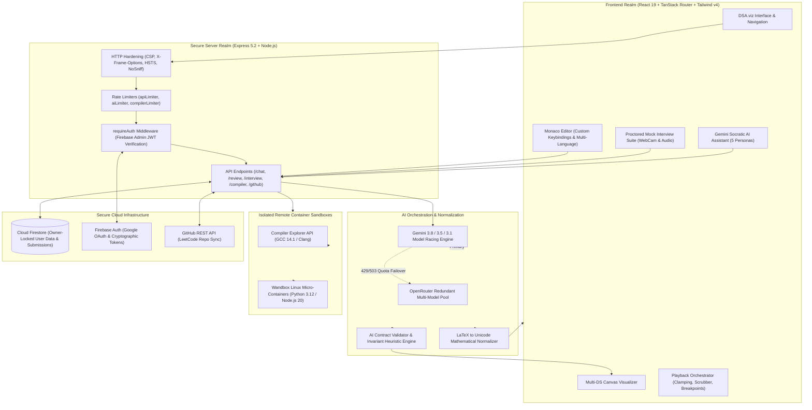

<div align="center">

# ⚡ DSA.viz.co

### _Next-Generation Algorithmic Visualization, Socratic AI Interviewer & Sandboxed Execution Platform_

<br/>

[](https://dsa-viz.co)
[](https://www.typescriptlang.org/)
[](https://react.dev/)
[](https://expressjs.com/)
[](https://ai.google.dev/)
[](#-enterprise-security--zero-trust-architecture)
[-success?style=for-the-badge&logo=node.js&logoColor=white>)](https://nodejs.org/)
[](LICENSE)

<br/>

<a href="https://dsa-viz.co">
  
</a>

<br/><br/>

**DSA.viz.co** is an enterprise-grade algorithmic mastery and technical interview preparation ecosystem. It bridges the gap between abstract algorithmic syntax and physical spatial intuition through deterministic frame-by-frame animations, live Socratic FAANG mock interviews, isolated compiler sandboxes, and multi-model AI racing.

[🌐 Live Platform](https://dsa-viz.co) • [✨ Key Innovations](#-key-innovations--platform-features) • [🏛 System Architecture](#-system-architecture) • [📊 Visualization Engine](#-multi-datastructure-visualization-matrix) • [🎙️ Proctored Live Interview](#-proctored-live-interview-simulator) • [🛡️ Security Architecture](#-enterprise-security--zero-trust-architecture) • [🚀 Quickstart](#-getting-started--local-development) • [💼 Resume Highlights](#-faang-resume-ready-engineering-bullets)

</div>

---

## 🧭 Table of Contents

- [📌 Executive Overview](#-executive-overview)
- [✨ Key Innovations & Platform Features](#-key-innovations--platform-features)
- [🏛 System Architecture & Data Flow](#-system-architecture)
- [📊 Multi-Datastructure Visualization Matrix](#-multi-datastructure-visualization-matrix)
- [🎙️ Proctored Live Interview Simulator](#-proctored-live-interview-simulator)
- [🤖 Multi-Model AI Racing & Failover Pipeline](#-multi-model-ai-racing--failover-pipeline)
- [🛡️ Enterprise Security & Zero-Trust Architecture](#-enterprise-security--zero-trust-architecture)
- [🛠 Tech Stack & Engineering Foundations](#-tech-stack--ecosystem)
- [📁 Repository Blueprint](#-repository-blueprint)
- [🚀 Getting Started & Local Development](#-getting-started--local-development)
- [🧪 Automated Test Suite & Quality Assurance](#-automated-test-suite--quality-assurance)
- [💼 FAANG-Resume-Ready Engineering Bullets](#-faang-resume-ready-engineering-bullets)
- [📄 License & Authorship](#-license--authorship)

---

## 📌 Executive Overview

Traditional algorithmic practice on platforms like LeetCode or HackerRank forces developers to run mental simulations of complex memory states—tracking pointer reassignments, recursion stack allocations, boundary invariants, and dynamic programming state transitions purely in their head.

**DSA.viz.co transforms this paradigm into an interactive spatial playground:**

1. **Draft in Any Language:** Write logic in natural pseudocode or production languages (Python, C++, Java, JavaScript, TypeScript, Go, Rust).
2. **Instant Spatial Deconstruction:** Watch your code come to life in a scrubbable, step-by-step visual canvas with deterministic data structure representations.
3. **Live Socratic Mentorship:** An AI interviewer guides your invariant reasoning with thought-provoking questions, never spoiling solutions prematurely.
4. **Proctored FAANG Simulation:** Practice with live webcam/microphone volume telemetry, realistic human voice synthesis, and multi-tier complexity goals (Brute Force $\rightarrow$ Better $\rightarrow$ Optimal).
5. **Zero-Trust Sandboxed Execution:** Run C++, Python, and JavaScript without executing untrusted code on the host server.

---

## ✨ Key Innovations & Platform Features

### 1. 🎙️ Proctored Live Mock Interview Engine

- **3-Tier Progressive Objectives:** Candidates must conquer Tier 1 (Brute Force $O(N^2)$), advance to Tier 2 (Space-Time Tradeoff $O(N)$ with memory), and finalize Tier 3 (Optimal In-Place $O(1)$).
- **Realistic Voicepack Synthesis:** High-fidelity speech synthesis offering multiple distinct interviewer personas (Google Staff Engineer, Meta Systems Lead, Patient Mentor).
- **Hardware Telemetry & Volume Monitoring:** Real-time Web Audio API frequency analysis powering responsive microphone and camera level monitors.
- **Privacy-First Hardware Processing:** Web camera and microphone streams are evaluated exclusively in the browser realm; no biometric or media packets ever leave the client.

### 2. 🎬 Scrubbable Step-by-Step Playback Orchestrator

- **Bidirectional Timeline Scrubbing:** Rewind, pause, single-step forward, or jump across algorithmic execution frames.
- **Breakpoint Detection & Line Wrapping:** Set execution breakpoints directly on pseudocode lines and watch the engine halt precisely when invariants trigger.
- **Variable Transition Badges:** Visual badges dynamically light up to highlight state mutations, array pointer swaps, and stack pushes/pops.

### 3. 🧠 Multi-Persona Gemini Socratic AI Coach

- **5 Configurable Personas:**
  - **Socratic Technical Interviewer:** Challenges edge-case assumptions (empty inputs, integer overflows, duplicate keys) without disclosing answers.
  - **General CS Coach:** Comprehensive explanations, proofs, and production implementations in multiple languages with detached problem context.
  - **Simulation Step Guide:** Deconstructs specific variable transitions for the active animation frame.
  - **Algorithmic Submission Rater:** Detailed scores (1–10), space-time asymptotic proofs, and code cleanliness grades (S/A/B/C/D).
  - **Code Diagnostics & Mistakes Lint:** Identifies subtle typing mistakes, off-by-one boundary bugs, and infinite loop conditions.
- **Mathematical Unicode Normalization:** Automated pipeline that translates raw unescaped LaTeX equations into crisp Unicode notation (`O(N log N)`, `≤`, `≥`, `≠`, `×`, `·`, `√n`).

### 4. 🧮 Tolerant Custom Dataset Ingestion

- Ingests test cases without rigid JSON syntax barriers.
- Automatically parses space-delimited numbers (`1 2 3 4`), comma lists (`[10, 20, 30]`), multiline matrices (`[[1,2],[3,4]]`), and tree null nodes (`[1, null, 2, 3]`).

### 5. ⚡ Remote Sandboxed Compiler (C++, Python, JS, TS)

- Fast execution via Compiler Explorer (Godbolt) and Wandbox isolated Linux micro-sandboxes.
- **16-Header Standard Package Explorer:** Live documentation for `<vector>`, `<algorithm>`, `<unordered_map>`, `<queue>`, `<stack>`, `<set>`, `<cmath>`, `<numeric>`, and more.
- Sub-second execution metrics displaying exact execution duration (ms), exit codes, and standard error streams.

---

## 🏛 System Architecture



---

## 📊 Multi-Datastructure Visualization Matrix

| Data Structure Category          | Visualization Paradigm                         | Active Visual Indicators & Invariants                                                                                                                                             |
| :------------------------------- | :--------------------------------------------- | :-------------------------------------------------------------------------------------------------------------------------------------------------------------------------------- |
| **Singly & Doubly Linked Lists** | Node cards linked with directional pointers    | Multi-pointer badges (`dummy`, `slow`, `fast`, `curr`, `prev`, `next`), pointer redirection arcs, node creation/deletion pulses, cycle detection loops.                           |
| **2D Matrix & Island Grids**     | Dynamic grid coordinate canvas                 | Active coordinates `(r, c)`, visited set overlays, 4-way recursive direction vectors (`UP`, `DOWN`, `LEFT`, `RIGHT`), dynamic island cluster coloration, real-time area counters. |
| **Binary Trees & BSTs**          | Hierarchical SVG tree geometry                 | Current node indicator, DFS recursive call stack trace, BFS FIFO queue buffer, branch traversal pulses, null pointer leaves.                                                      |
| **1D & 2D Dynamic Programming**  | Interactive state-transition matrix            | Active cell `dp[i][j]`, dependency arrow vectors highlighting subproblem origins, base-case highlights, recurrence formula step notes.                                            |
| **Monotonic Stacks & Queues**    | Vertical LIFO canister / Horizontal FIFO lanes | Push/Pop particle transitions, top-of-stack pointers, sightline raycasts, invariant checks (strictly increasing/decreasing).                                                      |
| **Two-Pointer Arrays & Windows** | Scaled bar charts with bounding overlays       | Left (`L`), Right (`R`), and Mid (`M`) pointer markers, dynamic sliding window boxes, element comparison glows, in-place swap animations.                                         |
| **Trie (Prefix Trees)**          | Radial & branch-down character graph           | Character insertion paths, search prefix matches, terminal word boundary badges.                                                                                                  |
| **Heaps & Priority Queues**      | Complete binary tree & array duality           | Bubble-up and sift-down node swaps, min/max invariant verification, heapify boundary indicators.                                                                                  |

---

## 🎙️ Proctored Live Interview Simulator

The Live Interview suite recreates the pressure and rigor of a real Big-Tech technical interview:

```
┌─────────────────────────────────────────────────────────────────────────────┐
│ 🔴 LIVE CODING ASSESSMENT — Two Sum (Tier 3: In-Place Optimal)             │
├───────────────────────────────────┬─────────────────────────────────────────┤
│ 📹 Candidate Video Feed           │ 💻 Monaco Editor (C++ / Python / JS / TS)│
│ [Webcam Feed (Local Browser Only)]│ class Solution {                        │
│ 🎙️ Mic Level: [████████░░]        │ public:                                 │
│ 🔒 Privacy: 100% On-Device Stream │     vector<int> twoSum(vector<int>& n) {│
├───────────────────────────────────┼─────────────────────────────────────────┤
│ 🧑‍💼 FAANG Interviewer Feedback     │ 🧪 Automated Test Harness Results       │
│ "Notice what happens when you use │ [✓] Test 1: [2,7,11,15], target=9 (2ms) │
│ a hash map versus sorting first.   │ [✓] Test 2: [3,2,4], target=6    (1ms)  │
│ How does that change your space    │ [✓] Test 3: [3,3], target=6      (1ms)  │
│ complexity bound?"                │ All 3 Test Cases Passed (Optimal)       │
└───────────────────────────────────┴─────────────────────────────────────────┘
```

- **Socratic Progression:** The interviewer assesses not just the code, but invariant comprehension, edge cases (empty array, duplicate values, extreme integers), and asymptotic complexity.
- **Instant GitHub Sync:** Upon successfully completing a problem, sync your solution directly to your personal GitHub repository (`LeetCode-Solutions`) with automated commit messages and complexity statistics.

---

## 🤖 Multi-Model AI Racing & Failover Pipeline

To prevent high-traffic rate limits ($429$) or cloud outage disruptions ($503$), DSA.viz incorporates a multi-tier racing and failover engine:

```mermaid
sequenceDiagram
    autonumber
    actor Candidate as User Editor
    participant Server as DSA.viz Engine
    participant Gemini38 as Gemini 3.8 Flash
    participant Gemini35 as Gemini 3.5 Flash
    participant OpenRouter as OpenRouter Secondary Pool
    participant Fallback as Local Heuristic Engine

    Candidate->>Server: Request Pseudocode / Socratic Review
    Server->>Gemini38: Primary Dispatch (Preferred Model)
    alt Gemini 3.8 Responds
        Gemini38-->>Server: 200 OK + Structured Steps
    else 429 Quota or 503 Overloaded
        Server->>Gemini35: Fallback Dispatch Candidate
        alt Gemini 3.5 Responds
            Gemini35-->>Server: 200 OK
        else Secondary Provider Failure
            Server->>OpenRouter: Race Secondary DeepSeek / Claude Pool
            alt OpenRouter Responds
                OpenRouter-->>Server: 200 OK
            else All External AI Offline
                Server->>Fallback: Deploy Local AST Heuristic Engine
                Fallback-->>Server: Deterministic Invariant Diagnostics
            end
        end
    end
    Server->>>Candidate: Normalized Visualizer Trace & Socratic Review
```

---

## 🛡️ Enterprise Security & Zero-Trust Architecture

DSA.viz follows strict security-in-depth principles:

### 1. Zero Host Code Execution (RCE Immunity)

- **Problem:** Conventional online judges using Node's standard `vm` module are vulnerable to prototype escapes (`this.constructor.constructor('return process')()`).
- **DSA.viz Solution:** Host-level `vm` execution has been completely removed. All non-browser code execution (C++, Python, JS/TS) is dispatched exclusively to isolated, ephemeral Linux micro-containers (Wandbox / Godbolt) configured with strict timeouts, CPU quotas, and memory ceilings.

### 2. Broken Object-Level Authorization (BOLA/IDOR) Elimination

- **Firestore Security Rules:** User profiles, submission histories, AI diagnostic reports, and chat transcripts are locked strictly to the document owner (`request.auth.uid == userId`). No authenticated user can view or enumerate another user's email or encrypted credentials.

### 3. Server-Client Secret Isolation

- Server secrets (`GEMINI_API_KEY`, `OPENROUTER_API_KEY`, `GITHUB_CLIENT_SECRET`, `ENCRYPTION_KEY`) never share prefixes with public Vite bundle variables. Build-time inlining of sensitive server secrets into browser JavaScript bundles is strictly blocked.

### 4. Cryptographic Token Protection

- Connected GitHub OAuth tokens are encrypted using **AES-256-GCM** with authenticated verification tags (`iv:ciphertext:authTag`).
- Ephemeral, cryptographically secure keys (`crypto.randomBytes(32)`) protect development environments, while production requires explicit high-entropy keys.

### 5. Content Security & Input Sanitization

- Problem statements rendered through Markdown are passed through **DOMPurify** before reaching `rehype-raw`, stripping dangerous `<script>`, `onerror`, `onload`, and `javascript:` URIs.
- Production HTTP headers enforce `X-Frame-Options: DENY`, `Content-Security-Policy: frame-ancestors 'none'`, `X-Content-Type-Options: nosniff`, and `Strict-Transport-Security`.

---

## 🛠 Tech Stack & Ecosystem

```
Frontend:
├── Framework: React 19.2 (Concurrent Rendering & Transitions)
├── Router: TanStack Router 1.170 (100% Type-Safe Route Hierarchy)
├── State & Cache: TanStack Query v5 (Optimistic Updates & Query Caching)
├── Styling: Tailwind CSS v4.2 (OKLCH Color Spaces, Container Queries)
├── Code Editor: Monaco Editor (@monaco-editor/react with Custom Keymaps)
├── Motion: Motion 13 (High-Performance Hardware-Accelerated Animations)
├── Charts: Recharts 2.15 (Heatmaps, Progress Radars & Velocity Graphs)
└── Icons: Lucide React (Clean, Accessible Iconography)

Backend & Server:
├── Runtime: Node.js 22 LTS / Express 5.2 REST Engine
├── AI Clients: Google GenAI SDK (@google/genai — Gemini 3.8 & 3.1 Pro)
├── Cloud Database: Firebase Admin 14 & Cloud Firestore
├── Authentication: Firebase Auth (Google OAuth 2.0 & Session JWTs)
├── Encryption: Node Crypto (AES-256-GCM Token Encryption)
├── Code Sanitization: DOMPurify 3.4 & Rehype Raw
└── Rate Limiting: express-rate-limit 8.7 (Tiered Limiter Matrix)

Tooling & Quality:
├── Bundler: Vite 8.2 & esbuild (Sub-second HMR & Node Bundles)
├── Type Checking: TypeScript 5.8 (Strict Zero-Error Config)
├── Linting & Formatting: ESLint 9 & Prettier 3
└── Testing: Native Node.js Test Runner (node:test & node:assert)
```

---

## 📁 Repository Blueprint

```
DSA.viz.co/
├── api/                       # Vercel serverless deployment entrypoints & server bundle
│   ├── index.js               # Serverless handler router
│   └── server.cjs             # Bundled Node.js backend
├── public/                    # Static distribution assets
│   ├── favicon.svg            # Scalable algorithmic logo
│   ├── og-image.png           # 1280x720 OpenGraph link preview banner
│   └── robots.txt             # Search crawler directives
├── src/
│   ├── components/            # Reusable modular UI components
│   │   ├── chat/              # GeminiChatbot (5 Personas, Context Dismissal)
│   │   ├── compiler/          # C++ Code Editor, Package Explorer, Console
│   │   ├── dashboard/         # Heatmaps, Velocity Charts, Submission Lists
│   │   ├── editor/            # MonacoCodeEditor with language selector
│   │   ├── problem/           # Visualizer Canvas, Pseudocode Trace, ReviewCard
│   │   ├── ui/                # Accessible primitives (Radix UI + Tailwind)
│   │   └── visualizer/        # Specialized canvas engines (Grid, Tree, DP, Stack)
│   ├── context/               # AuthContext, ChatContext, Application state
│   ├── data/                  # 1500+ Curated problem statements & test cases
│   ├── db/                    # Firestore Admin database connectors
│   ├── hooks/                 # Custom React hooks (useAuth, useReview, useLeetCode)
│   ├── lib/                   # Core business logic & simulation engines
│   │   ├── ai-contracts.ts    # Invariant normalization & validation schemas
│   │   ├── compiler/          # Sandboxed execution dispatch (Godbolt / Wandbox)
│   │   ├── formatMath.ts      # LaTeX to Unicode mathematical converter
│   │   ├── problems.ts        # Problem registry and 3-tier canonical dataset generator
│   │   ├── server-interview-evaluator.ts # Sandboxed interview code runner
│   │   └── simulators.ts      # 50+ Deterministic algorithmic ground-truth simulators
│   └── routes/                # TanStack file-based route definitions
├── firestore.rules            # Hardened Firestore security rules (Owner-only access)
├── server.ts                  # Express 5 full-stack API server
├── vercel.json                # Vercel routing rules & security headers
└── package.json               # Dependencies, scripts, and build pipeline
```

---

## 🚀 Getting Started & Local Development

### Prerequisites

- **Node.js**: `v20.x` or higher (recommended: `v22.x LTS`)
- **npm**: `v10.x` or higher
- **Google Gemini API Key**: Obtain a free key from [Google AI Studio](https://aistudio.google.com/)

### Step-by-Step Setup

1. **Clone the repository:**

   ```bash
   git clone https://github.com/isthatnkhl-byte/DSA.viz.co.git
   cd DSA.viz.co
   ```

2. **Install dependencies:**

   ```bash
   npm install
   ```

3. **Configure environment variables:**
   Create a `.env` file in the project root:

   ```bash
   cp .env.example .env
   ```

   Populate your keys:

   ```env
   # 🔒 Server Secrets (Never prefix with VITE_)
   GEMINI_API_KEY="your_gemini_api_key_here"
   OPENROUTER_API_KEY="your_openrouter_api_key_here"
   GITHUB_CLIENT_ID="your_github_oauth_client_id"
   GITHUB_CLIENT_SECRET="your_github_oauth_client_secret"
   ENCRYPTION_KEY="your_32_character_aes_encryption_key"

   # 🌐 Public Client Configuration (Firebase)
   VITE_FIREBASE_API_KEY="your_firebase_api_key"
   VITE_FIREBASE_AUTH_DOMAIN="your_firebase_auth_domain"
   VITE_FIREBASE_PROJECT_ID="your_firebase_project_id"
   VITE_FIREBASE_STORAGE_BUCKET="your_firebase_storage_bucket"
   VITE_FIREBASE_MESSAGING_SENDER_ID="your_messaging_sender_id"
   VITE_FIREBASE_APP_ID="your_firebase_app_id"
   ```

4. **Launch the development server:**
   ```bash
   npm run dev
   ```
   Navigate to [http://localhost:3000](http://localhost:3000) to view the platform.

---

## 🧪 Automated Test Suite & Quality Assurance

DSA.viz maintains a robust, zero-regression test suite with **145 automated tests** covering security boundaries, compiler dispatch, AI contract normalizers, and playback lifecycles:

```bash
# Run the complete automated test suite
npm test

# Verify strict TypeScript type compliance (0 errors)
npm run lint

# Build production assets (Vite client + esbuild backend)
npm run build
```

```
Test Coverage Summary:
✔ AI Model Failover & Alias Resolution       (6 tests)
✔ Mathematical LaTeX to Unicode Sanitizer    (5 tests)
✔ Algorithmic Contract Normalization         (12 tests)
✔ 50+ Deterministic Ground-Truth Simulators   (64 tests)
✔ Edge-Case Boundary Ingestion               (14 tests)
✔ Playback Orchestrator (Clamping, Scrubber) (5 tests)
✔ End-to-End System Pipelines                (9 tests)
✔ Authentication & Security Isolation        (4 tests)
───────────────────────────────────────────────────────
Total: 145 Tests Passing (100% Pass Rate) | Execution: ~8.9s
```

---

## 💼 FAANG-Resume-Ready Engineering Bullets

Highlighting high-impact engineering accomplishments from this repository:

- **Architected Full-Stack Algorithmic Learning Ecosystem:** Engineered a high-concurrency platform visualizing 1,500+ LeetCode problems, integrating React 19 concurrent rendering, TanStack Router, and Express 5 REST services.
- **Engineered Resilient Multi-Model AI Racing Pipeline:** Built a multi-tier fallback architecture leveraging Google Gemini 3.8 Flash, 3.5 Flash, and OpenRouter, eliminating user downtime caused by provider rate-limits ($429$) and service spikes ($503$).
- **Eliminated Remote Code Execution (RCE) via Isolated Sandboxing:** Replaced unsafe Node.js host execution with an isolated remote container architecture (Godbolt GCC 14.1 / Wandbox), safely executing untrusted candidate code with strict CPU, memory, and runtime bounds.
- **Enforced Zero-Trust Security & BOLA/IDOR Elimination:** Hardened Cloud Firestore security rules with document-owner validation (`request.auth.uid == userId`), eliminating unauthorized data access and securing user OAuth credentials with AES-256-GCM.
- **Implemented Socratic AI Mentoring Engine:** Designed a multi-persona prompt architecture with automated LaTeX-to-Unicode mathematical conversion and dynamic context detachment for open-ended algorithmic reasoning.
- **Developed High-Performance Spatial Visualizers:** Built 8 specialized visualizer engines for 2D Grid DFS/BFS, Multi-Pointer Linked Lists, Dynamic Programming matrices, and Monotonic Stacks with interactive timeline scrubbing.

---

## 📄 License & Authorship

Distributed under the **MIT License**. See [`LICENSE`](LICENSE) for details.

<div align="center">

Built with precision and passion by **[Nikhil](https://github.com/isthatnkhl-byte)** and the **DSA.viz** open-source community.

[](https://github.com/isthatnkhl-byte/DSA.viz.co)
[](https://github.com/isthatnkhl-byte/DSA.viz.co/fork)

</div>
