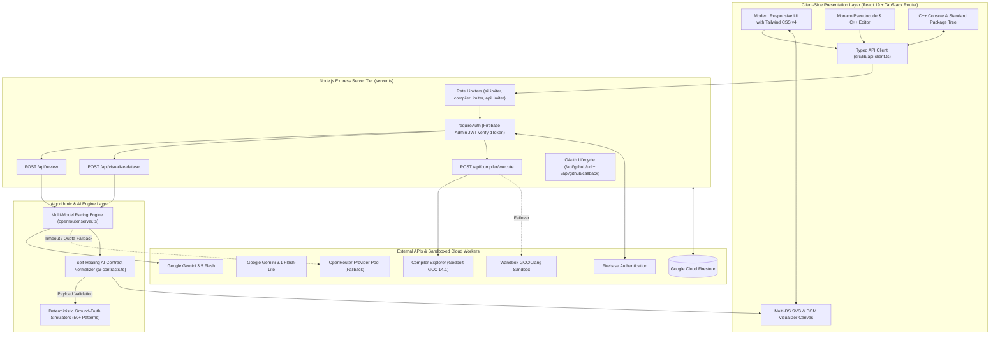

# DSA.viz System Architecture & Engineering Specifications

This document outlines the end-to-end architectural topology, server-side data lifecycle, multi-model racing heuristics, and security perimeter for **DSA.viz.co**.

---

## 1. High-Level Architectural Topology

DSA.viz is built on a fullstack isomorphic React 19 architecture backed by a high-performance **Node.js Express REST API**, **Firebase Admin Auth**, and **Google Cloud Firestore**. It leverages a strictly typed client-server API boundary (`src/lib/api-client.ts`) to isolate client-side UI rendering from server-side AI model-racing and sandboxed C++ compilers.



---

## 2. Express REST API Pipeline

The client communicates with the server through a strictly typed API client. Each endpoint enforces Zod schema validation, rate limiting, and cryptographic token verification:

### Key Endpoints:

1. **`POST /api/review`**
   - **Input:** `{ slug: string, title: string, difficulty?: string, topics?: string[], pseudocode: string }`
   - **Rate Limiting:** `aiLimiter` (40 requests / minute)
   - **Execution:** Calls Gemini 3.5 Flash with algorithmic grading rubric. Returns verdict, asymptotic complexities, optimization nudge, praise, and code line mapping.

2. **`POST /api/visualize-dataset`**
   - **Input:** `{ slug: string, dataset: TestDataset, pseudocode: string }`
   - **Rate Limiting:** `aiLimiter` (40 requests / minute)
   - **Execution:** Generates step-by-step state mutations (`VizStep[]`). Passes raw output through `ai-contracts.ts` normalizer. If LLM trace is malformed, seamlessly falls back to deterministic ground-truth simulator in `simulators.ts`.
   - **Guaranteed Output:** Never fails to produce a navigable visual animation.

3. **`POST /api/compiler/execute`**
   - **Input:** `{ code: string, stdin?: string }`
   - **Rate Limiting:** `compilerLimiter` (20 requests / minute) + In-flight concurrency guard (max 5 simultaneous runs)
   - **Execution:** Validates bracket balance and syntax, dispatches to Compiler Explorer (Godbolt) with Wandbox failover, returns stdout, stderr, compile exit code, and execution status.

4. **`GET /api/statement`**
   - **Input:** `?slug=two-sum`
   - **Execution:** Reads canonical problem description and examples from `src/data/statements.json` or dynamic fallback synthesizers.

---

## 3. Multi-Model Racing & Resilient Fallback Architecture

To ensure 99.9% uptime during peak interview prep hours, DSA.viz implements a non-blocking multi-model fallback matrix:

```
[User Request]
       │
       ▼
[Primary Tier: Google Gemini 3.7 Flash] ──── (Success < 2s) ───► [Return Result]
       │ (Timeout > 4.5s or Quota 429)
       ▼
[Secondary Tier: Gemini 3.1 Flash-Lite] ──── (Success) ────────► [Return Result]
       │ (Provider Outage)
       ▼
[Tertiary Tier: OpenRouter Failover Pool] ── (Success) ────────► [Return Result]
       │ (Network Partition)
       ▼
[Local Deterministic Ground-Truth Engine] ─ (Instant < 5ms) ───► [Normalized Simulation]
```

---

## 4. State Management & Theme Pipeline

The frontend maintains a clean separation between server cache and client interaction state:

- **Server Cache (TanStack Query):** Handles remote problem metadata, submission histories, and AI review responses with automatic stale-while-revalidate policies.
- **Visualizer State Engine (Zustand):** Manages step indices, animation playback speed ($0.5\times - 3.0\times$), active dataset selection, and highlighted node references.
- **Dynamic Accent Engine (Zustand + CSS Variables):** Enables instantaneous theme color switching across 8 customized developer palettes (Emerald, Cyan, Indigo, Violet, Rose, Amber, Slate, Cyberpunk) without layout re-renders.
