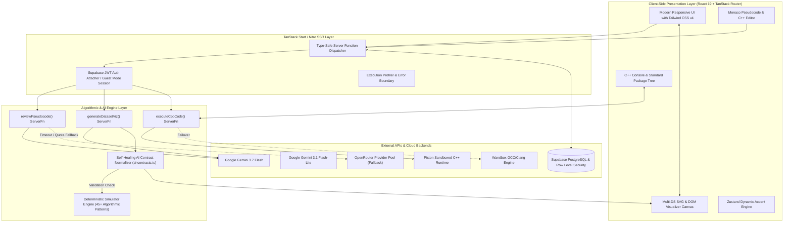

# DSA.viz System Architecture & Engineering Specifications

This document outlines the end-to-end architectural topology, server-side data lifecycle, multi-model racing heuristics, and security perimeter for **DSA.viz.co**.

---

## 1. High-Level Architectural Topology

DSA.viz is built on a fullstack isomorphic React 19 architecture powered by **TanStack Start** and **Nitro SSR**. It leverages type-safe Remote Procedure Call (RPC) Server Functions (`createServerFn`) to unify the client state machine with distributed server-side AI and sandboxed execution workers.



---

## 2. Server Functions RPC Pipeline

TanStack Start replaces traditional REST/GraphQL boilerplate with isomorphic server functions. Each server function enforces input schema validation, attaches user session tokens, and returns strictly typed response objects:

### Key Server Functions:

1. **`reviewPseudocode` (`src/lib/review.functions.ts`)**
   - **Input:** `{ slug: string, code: string, language: string, datasetIndex: number }`
   - **Execution:** Calls Gemini 3.7 Flash with interview rubric system instructions. Renders verdict, asymptotic complexities, optimization tips, and line-by-line feedback.
   - **Performance:** Streamlined for $<1.8\text{s}$ response latency.

2. **`generateDatasetViz` (`src/lib/review.functions.ts`)**
   - **Input:** `{ slug: string, code: string, dataset: TestDataset }`
   - **Execution:** Generates step-by-step state mutations (`VizStep[]`). Passes raw output through `ai-contracts.ts` normalizer. If LLM trace is malformed, seamlessly defaults to deterministic ground-truth simulator in `simulators.ts`.
   - **Guaranteed Output:** Never fails to produce a navigable visual animation.

3. **`executeCppCode` (`src/lib/compiler.functions.ts`)**
   - **Input:** `{ code: string, stdin?: string, flags?: string[], backend?: "piston" | "wandbox" }`
   - **Execution:** Validates against dangerous syscalls, sends payload to sandboxed environment, streams stdout, stderr, compile exit code, and execution time (ms).

4. **`fetchStatements` (`src/lib/statements.server.ts`)**
   - **Input:** `{ slug: string }`
   - **Execution:** Reads canonical problem description and examples from `data/statements.json`, rendering formatted Markdown on the server.

---

## 3. Multi-Model Racing & Resilient Fallback Architecture

To ensure 99.9% uptime during peak interview prep hours, DSA.viz implements a non-blocking multi-model fallback matrix:

```
[User Request]
       │
       ▼
[Primary Tier: Google Gemini 3.7 Flash] ──── (Success < 2s) ───► [Return Result]
       │ (Timeout > 4.5s or Quota 429)
       ▼
[Secondary Tier: Gemini 3.1 Flash-Lite] ──── (Success) ────────► [Return Result]
       │ (Provider Outage)
       ▼
[Tertiary Tier: OpenRouter Failover Pool] ── (Success) ────────► [Return Result]
       │ (Network Partition)
       ▼
[Local Deterministic Ground-Truth Engine] ─ (Instant < 5ms) ───► [Normalized Simulation]
```

---

## 4. State Management & Theme Pipeline

The frontend maintains a clean separation between server cache and client interaction state:

- **Server Cache (TanStack Query):** Handles remote problem metadata, submission histories, and AI review responses with automatic stale-while-revalidate policies.
- **Visualizer State Engine (Zustand):** Manages step indices, animation playback speed ($0.5\times - 3.0\times$), active dataset selection, and highlighted node references.
- **Dynamic Accent Engine (Zustand + CSS Variables):** Enables instantaneous theme color switching across 8 customized developer palettes (Emerald, Cyan, Indigo, Violet, Rose, Amber, Slate, Cyberpunk) without layout re-renders.
